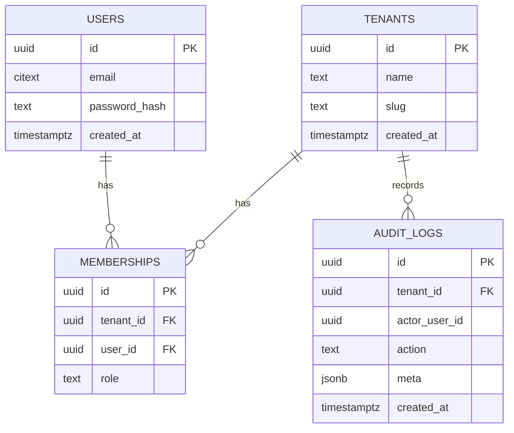

# ERD — {{PROJECT_NAME}}

**Tenancy model:** shared database, `tenant_id` column on every tenant-owned table (see ADR-0001).
**Updated:** <yyyy-mm-dd>

## Entities

### tenants (platform)
| column | type | null | default | notes |
|---|---|---|---|---|
| id | uuid | no | generated | PK |
| name | text | no | | |
| slug | text | no | | unique |
| created_at | timestamptz | no | now() | |
| updated_at | timestamptz | no | now() | |

<!-- Copy this block per entity. Mark (tenant-owned) and (PII) in the heading. List indexes below each table. -->
